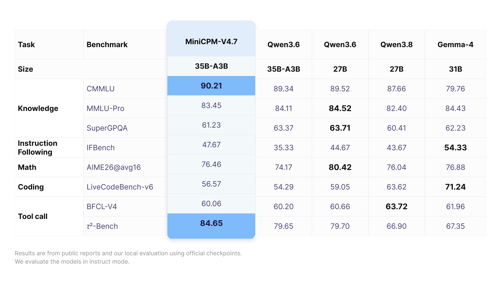
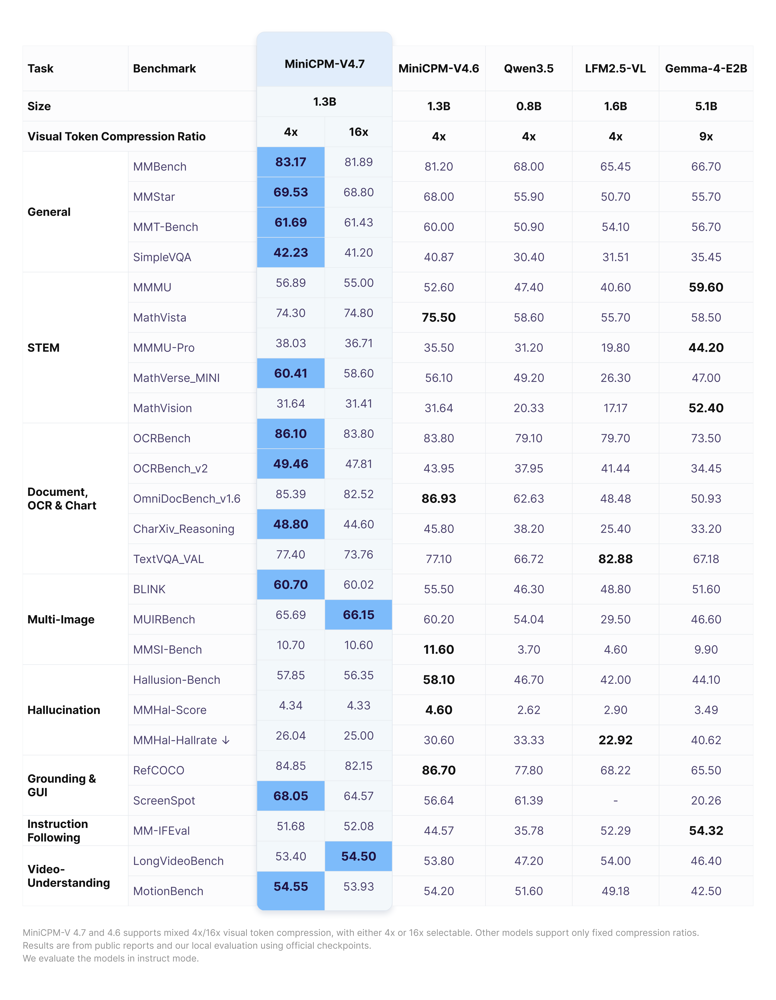
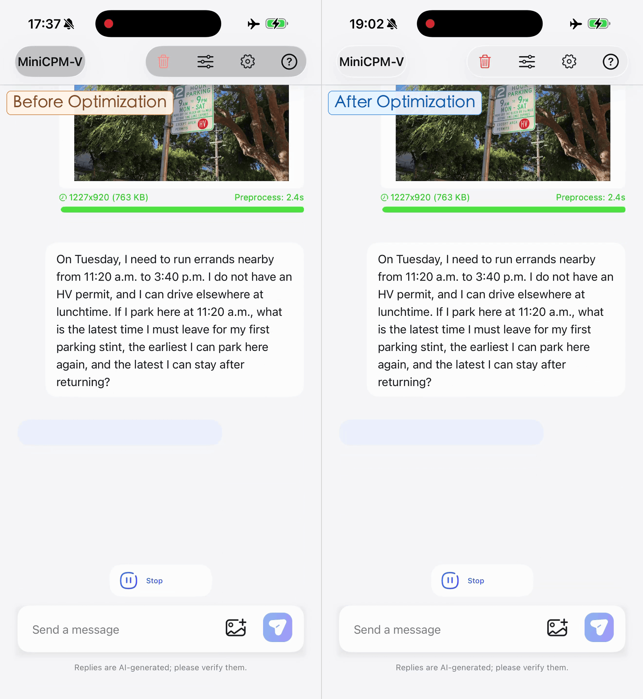

<div align="center">

<a href="./docs/minicpm_v4dot7_en.md"></a>

**MiniCPM-V & MiniCPM-o · See, hear, and interact on your local devices.**

[中文](./README_zh.md) · **English**

<p>
  <strong><a href="#minicpm-v-47">MiniCPM-V 4.7</a></strong> &nbsp;·&nbsp; <a href="https://huggingface.co/openbmb/MiniCPM-V-4.7-35B-A3B">🤗 35B-A3B</a> &nbsp;·&nbsp; <a href="https://huggingface.co/openbmb/MiniCPM-V-4.7-1B">🤗 1B</a> &nbsp;·&nbsp; <a href="https://huggingface.co/spaces/openbmb/MiniCPM-V-4.7-Demo">🤖 Demo</a>
  <br>
  <strong><a href="#minicpm-o-45">MiniCPM-o 4.5</a></strong> &nbsp;·&nbsp; <a href="https://huggingface.co/openbmb/MiniCPM-o-4_5">🤗 9B</a> &nbsp;·&nbsp; <a href="https://minicpmo45.modelbest.cn">🤖 Demo</a>
</p>

<p>
  <sub><a href="#model-overview">Overview</a> &nbsp;·&nbsp; <a href="#get-started">Get started</a> &nbsp;·&nbsp; <a href="#project-resources">Resources</a> &nbsp;·&nbsp; <a href="#citation">Citation</a></sub>
</p>

</div>

## MiniCPM-V 4.7

MiniCPM-V 4.7 is the latest model in the MiniCPM-V series, available in **35B-A3B and 1B variants**. The 35B-A3B variant is the series' first MoE model. Its main features include:

- **🚀 A new performance–efficiency Pareto frontier.** The 35B-A3B and 1B variants each advance the performance–efficiency Pareto frontier for multimodal large language models. In Instruct mode, 35B-A3B **achieves a higher overall score in less inference time than Qwen3.6 35B-A3B**; the 1B variant further improves on MiniCPM-V 4.6's core capabilities and **substantially outperforms Qwen3.5 0.8B in both overall score and inference efficiency**.
- **📱 The first open-source MoE to run smoothly on-device without compromising performance.** Powered by the latest [Lookahead Expert Scheduling (LES)](https://github.com/tc-mb/llama.cpp-omni/blob/master/docs/les/lookahead-expert-scheduling.md) inference acceleration technique, MiniCPM-V 4.7 35B-A3B becomes the first open-source MoE model to run smoothly on-device without compromising performance, achieving a **decoding speed of 13+ tokens/s with just 3 GB of memory** on iPhone 17 Pro Max.
- **🛠️ Broad platform support and easy customization.** MiniCPM-V 4.7 supports **iOS, Android, and HarmonyOS**, and **supports chip platforms from Intel, AMD, Arm, Rockchip, and Houmo**, covering a diverse range of mobile devices and local computing scenarios. We also open-source [Self-Replay Fine-Tuning](https://openbmb-dev.modelbest.co/blog/self-replay-fine-tuning), helping developers **extend model capabilities at low cost while reducing forgetting of existing capabilities**.

<a name="capability-alongside-inference-cost"></a>

### Significantly Advancing the Performance–Efficiency Pareto Frontier

<p align="center">
  <a href="./assets/minicpmv4.7/performance_efficiency_frontier.png"></a>
</p>

**Overall Performance (35B-A3B, Instruct)**

**Vision-Language**

<p align="center">
  <a href="./assets/minicpmv4.7/overall_performance_35ba3b_instruct.png"></a>
</p>

**Language**

<p align="center">
  <a href="./assets/minicpmv4.7/overall_performance_35ba3b_language.png"></a>
</p>

**Overall Performance (1B, Instruct)**

<p align="center">
  <a href="./assets/minicpmv4.7/overall_performance_1b_instruct.png"></a>
</p>

### Smooth On-Device MoE Inference without Compromising Performance

Running an MoE model on a device is only the starting point. **The real challenge is to preserve model capability while delivering smooth generation.** Storing expert weights on SSD can overcome memory capacity limits, but frequent loading stalls slow generation unless loading and computation overlap effectively. Restricting the number of experts or fixing an expert subset can speed up inference at the cost of model capability.

To address this trade-off, MiniCPM-V 4.7 introduces [Lookahead Expert Scheduling](https://github.com/tc-mb/llama.cpp-omni/blob/master/docs/les/lookahead-expert-scheduling.md), delivering a **5× speedup on real devices without sacrificing model capability**. Cross-layer routing prediction preloads experts likely to be needed by the next layer and prioritizes computation for experts selected by the actual router that are already loaded, substantially reducing loading stalls. Weight quantization and an optimized storage layout also reduce the storage footprint and make scattered reads more efficient, further accelerating loading. The recording below compares generation speed before and after inference optimization:

<a name="see-it-in-action"></a>

<p align="center">
  <a href="./assets/minicpmv4.7/moe_speed_comparison_en.gif"></a>
</p>

## MiniCPM-o 4.5

MiniCPM-o 4.5 is the latest model in the MiniCPM-o series, a **9B end-to-end omnimodal model**. It can continuously receive video and audio while generating speech and text, enabling real-time interactions that see, hear, and speak simultaneously.

**Model highlights:**

- **🔥 Vision capability approaching Gemini 2.5 Flash.** It scores 77.6 on average across 8 popular OpenCompass benchmarks. **With only 9B parameters, its visual understanding surpasses GPT-4o and Gemini 2.0 Pro**, and a single model supports both instruct and thinking modes.
- **🎙 Strong speech capability.** It supports bilingual real-time speech conversation with configurable voices in English and Chinese, making conversations **more natural, expressive, and stable**. A simple reference audio clip is enough for **voice cloning and role play**, and its voice cloning performance surpasses strong TTS tools such as CosyVoice2.
- **🎬 Full-duplex, proactive live interaction.** It process real-time, continuous video and audio input streams simultaneously while generating concurrent text and speech output streams in an end-to-end fashion, without mutual blocking. This **allows MiniCPM-o 4.5 to see, hear, and speak simultaneously**, enabling smooth, real-time omnimodal conversations. Beyond responding to requests, the model can also interact proactively, for example by initiating reminders or comments based on its continuous understanding of the scene.

<p align="center">
  <a href="https://www.youtube.com/watch?v=6UzC-O1Q-1U"></a>
</p>

<!-- [Live demo](https://minicpmo45.modelbest.cn) · [Web Demo Deployment](./docs/minicpm_o4dot5_en.md#web-demo-deployment) · [Examples](./docs/minicpm_o4dot5_en.md#examples) · [Limitations](./docs/minicpm_o4dot5_en.md#limitations) · [MiniCPM-o 4.5 evaluation](./docs/minicpm_o4dot5_en.md#evaluation) -->

<a name="model-zoo"></a>
<a name="choose-your-model"></a>

## Model overview

<table>
  <thead>
    <tr>
      <th align="left" width="180" nowrap="nowrap"></th>
      <th align="left"><b>MiniCPM-V 4.7</b></th>
      <th align="left"><b>MiniCPM-o 4.5</b></th>
    </tr>
  </thead>
  <tbody>
    <tr>
      <td nowrap="nowrap"><b>Models</b></td>
      <td>35B-A3B MoE · 1B</td>
      <td>9B end-to-end omnimodal model</td>
    </tr>
    <tr>
      <td nowrap="nowrap"><b>Core capabilities</b></td>
      <td>Image, multi-image, document and video understanding</td>
      <td>Visual understanding, speech understanding and generation</td>
    </tr>
    <tr>
      <td nowrap="nowrap"><b>Technical features</b></td>
      <td>Mixed 4×/16× visual token compression; smooth on-device inference without compromising performance</td>
      <td>Full-duplex multimodal live streaming, receiving audio and video while generating speech and text</td>
    </tr>
    <tr>
      <td nowrap="nowrap"><b>Model guides</b></td>
      <td><a href="./docs/minicpm_v4dot7_en.md">MiniCPM-V 4.7 model guide</a></td>
      <td><a href="./docs/minicpm_o4dot5_en.md">MiniCPM-o 4.5 model guide</a></td>
    </tr>
    <tr>
      <td nowrap="nowrap"><b>Examples</b></td>
      <td><a href="./docs/minicpm_v4dot7_en.md#examples">Examples</a></td>
      <td><a href="./docs/minicpm_o4dot5_en.md#examples">Examples</a></td>
    </tr>
    <tr>
      <td nowrap="nowrap"><b>Evaluation</b></td>
      <td><a href="./docs/minicpm_v4dot7_en.md#evaluation">Evaluation</a></td>
      <td><a href="./docs/minicpm_o4dot5_en.md#evaluation">Evaluation</a></td>
    </tr>
  </tbody>
</table>

## Get started

<table>
  <thead>
    <tr>
      <th align="left"><b>MiniCPM-V 4.7</b></th>
      <th align="left"><b>MiniCPM-o 4.5</b></th>
    </tr>
  </thead>
  <tbody>
    <tr>
      <td><a href="./docs/minicpm_v4dot7_en.md#model-weights">Model weights</a></td>
      <td><a href="./docs/minicpm_o4dot5_en.md#model-weights">Model weights</a></td>
    </tr>
    <tr>
      <td><a href="./docs/minicpm_v4dot7_en.md#inference-with-transformers">Inference</a></td>
      <td><a href="./docs/minicpm_o4dot5_en.md#inference-using-hugging-face-transformers">Inference</a></td>
    </tr>
    <tr>
      <td><a href="./docs/deployment_en.md#training-llama-factory-swift">Fine-tuning</a></td>
      <td><a href="./docs/minicpm_o4dot5_en.md#use-minicpm-o-45-in-other-inference-and-training-frameworks">Fine-tuning</a></td>
    </tr>
    <tr>
      <td><a href="https://huggingface.co/spaces/openbmb/MiniCPM-V-4.7-Demo">Live demo</a></td>
      <td><a href="https://minicpmo45.modelbest.cn">Live demo</a></td>
    </tr>
    <tr>
      <td><a href="./docs/minicpm_v4dot7_en.md#on-device-deployment">Local deployment</a></td>
      <td><a href="./docs/minicpm_o4dot5_en.md#web-demo-deployment">Local deployment</a></td>
    </tr>
    <tr>
      <td colspan="2" align="center"><a href="./docs/api.md">API</a></td>
    </tr>
    <tr>
      <td colspan="2" align="center"><a href="https://github.com/OpenSQZ/MiniCPM-V-CookBook">Cookbook</a></td>
    </tr>
  </tbody>
</table>

## Latest updates

- **2026-10-12 · MiniCPM-V 4.7 released** — the first open-source MoE model to run smoothly on-device without compromising performance, setting a new multimodal performance–efficiency Pareto frontier. [See what's new](./docs/minicpm_v4dot7_en.md).

- **2026-06-25** · MiniCPM-V 4.6 joined the [official Ollama model library](https://ollama.com/library/minicpm-v4.6).
- **2026-05-17** · Released [API access](./docs/api.md) for MiniCPM-V 4.6 and MiniCPM-o 4.5.
- **2026-05-11** · Released [MiniCPM-V 4.6](./docs/minicpm_v4dot6_en.md), with mixed 4×/16× visual token compression and mobile deployment support.

### Community milestones

- **2025-01-19** · MiniCPM-o reached No. 1 on GitHub Trending and No. 2 on Hugging Face Trending.
- **2024-05-23** · MiniCPM-V reached No. 1 on both GitHub Trending and Hugging Face Trending.

## Built with MiniCPM

| Project | What you can explore |
|:---|:---|
| [OpenAvatarChat](https://github.com/HumanAIGC-Engineering/OpenAvatarChat) | Interactive digital-human conversations on a single PC |
| [Ollama-OCR](https://github.com/imanoop7/Ollama-OCR) | Extract text from images and PDFs with local vision-language models |
| [comfyui_LLM_party](https://github.com/heshengtao/comfyui_LLM_party) | Connect language and vision models to ComfyUI workflows |

Community projects may support different model generations. Check each project's model list. [More community projects](./docs/project_en.md#awesome-work-using-minicpm-v--o)

<a name="docs--research"></a>

## Project resources

| Category | Links |
|:---|:---|
| **Model documentation** | [MiniCPM-V 4.7](./docs/minicpm_v4dot7_en.md) · [MiniCPM-o 4.5](./docs/minicpm_o4dot5_en.md) |
| **Deployment & development** | [Deployment & training](./docs/deployment_en.md) · [Cookbook](https://github.com/OpenSQZ/MiniCPM-V-CookBook) · [Documentation site](https://minicpm-o.readthedocs.io/en/latest/index.html) |
| **Papers** | [Technical reports & related papers](./docs/project_en.md#technical-reports-and-key-techniques-papers) |
| **Versions & updates** | [Earlier models](./docs/project_en.md#legacy-models) · [Full release history](./docs/changelog_en.md) |
| **Community** | [Discord](https://discord.com/invite/7q3ry8Ny8K) · [WeChat](./docs/wechat.md) · [Feishu / Lark](./assets/feishu_qrcode.png) · [MiniCPM Wiki](https://modelbest.feishu.cn/wiki/UtWxwcERfiRIpIkBOjuc3h9tn1D?fromScene=spaceOverview) |
| **License & usage** | [Apache-2.0](./LICENSE) · [Model license](./docs/project_en.md#model-license) · [Usage statement](./docs/project_en.md#statement) |

Developed by [THUNLP](https://nlp.csai.tsinghua.edu.cn/) and [ModelBest](https://modelbest.cn/). Code and model weights are released under Apache-2.0.

## Citation

If you find our model/code/paper helpful, please consider citing our papers 📝 and staring us ⭐️！

```bibtex
@misc{cui2026minicpmo45realtimefullduplex,
      title={MiniCPM-o 4.5: Towards Real-Time Full-Duplex Omni-Modal Interaction},
      author={Junbo Cui and Bokai Xu and Chongyi Wang and Tianyu Yu and Weiyue Sun and Yingjing Xu and Tianran Wang and Zhihui He and Wenshuo Ma and Tianchi Cai and others},
      year={2026},
      url={https://arxiv.org/abs/2604.27393},
}

@proceedings{yu2025minicpmv45cookingefficient,
      title={MiniCPM-V 4.5: Cooking Efficient MLLMs via Architecture, Data, and Training Recipe},
      author={Tianyu Yu and Zefan Wang and Chongyi Wang and Fuwei Huang and Wenshuo Ma and Zhihui He and Tianchi Cai and Weize Chen and Yuxiang Huang and Yuanqian Zhao and others},
      year={2025},
      url={https://arxiv.org/abs/2509.18154},
}

@article{yao2024minicpm,
  title={MiniCPM-V: A GPT-4V Level MLLM on Your Phone},
  author={Yao, Yuan and Yu, Tianyu and Zhang, Ao and Wang, Chongyi and Cui, Junbo and Zhu, Hongji and Cai, Tianchi and Li, Haoyu and Zhao, Weilin and He, Zhihui and others},
  journal={arXiv preprint arXiv:2408.01800},
  year={2024}
}
```
