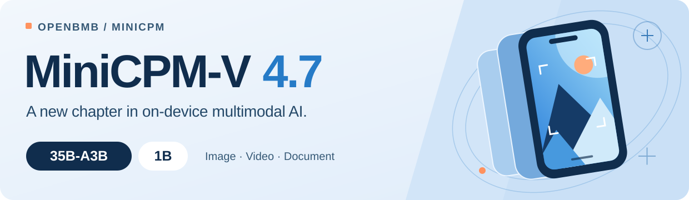
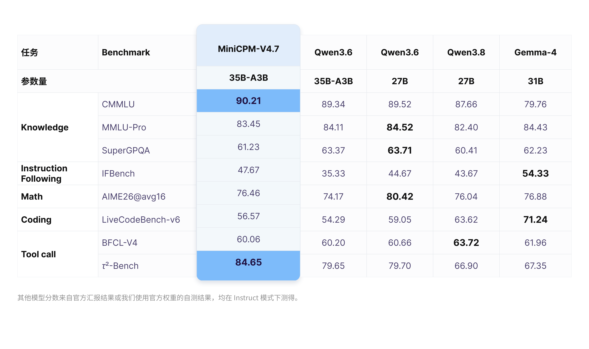
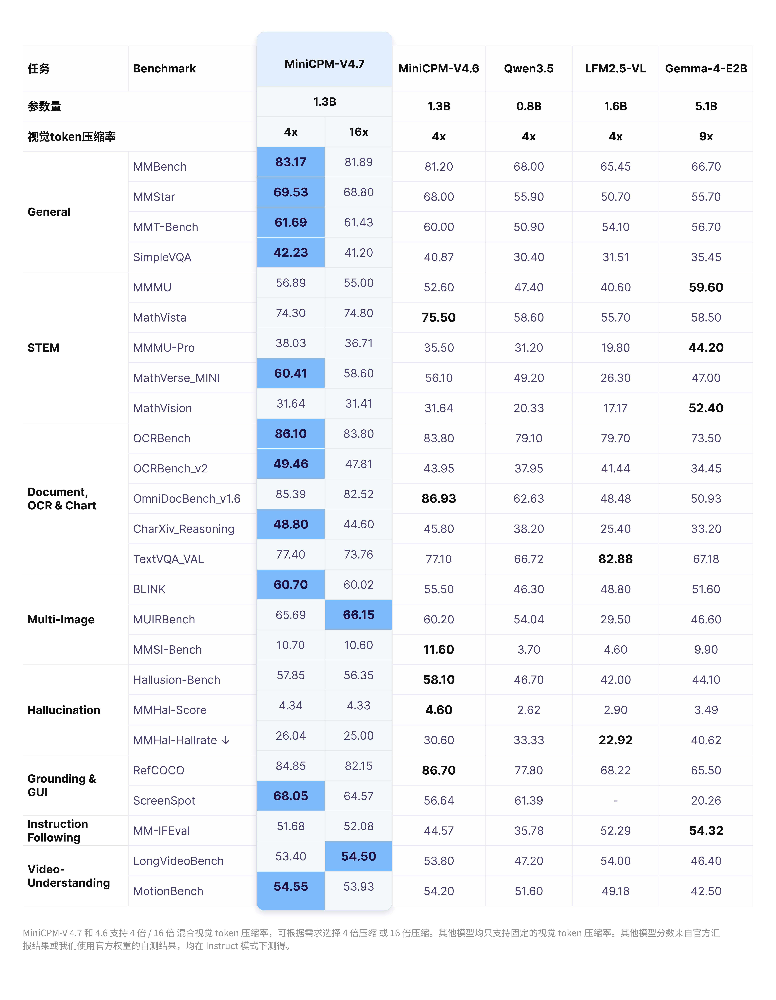
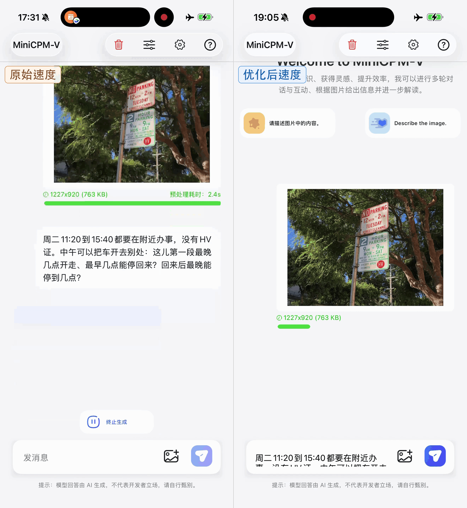

<div align="center">

<a href="./docs/minicpm_v4dot7_zh.md"></a>

**MiniCPM-V & MiniCPM-o · 把看、听、交互，带到你的端侧设备上。**

**中文** · [English](./README.md)

<p>
  <strong><a href="#minicpm-v-47">MiniCPM-V 4.7</a> &nbsp;·&nbsp; <a href="#minicpm-o-45">MiniCPM-o 4.5</a></strong>
  <br>
  <sub><a href="#模型概览">模型概览</a> &nbsp;·&nbsp; <a href="#开始使用">开始使用</a> &nbsp;·&nbsp; <a href="#项目资源">项目资源</a> &nbsp;·&nbsp; <a href="#引用">引用</a></sub>
</p>

</div>

## MiniCPM-V 4.7

MiniCPM-V 4.7 是 MiniCPM-V 系列的最新模型，提供 **35BA3B 和 1B 两种规格**，其中 35BA3B 是 MiniCPM-V 系列首个 MoE 模型。主要特点包括：

- **🚀 性能与效率的新帕累托前沿。** MiniCPM-V 4.7 以 35BA3B 与 1B 分别刷新了多模态大模型的性能—效率的帕累托前沿。在 Instruct 模式下，35BA3B **以更短的推理时间取得比 Qwen3.6 35BA3B 更高的综合得分**；1B 版本相比 MiniCPM-V 4.6 持续提升基础能力，并在**综合得分和推理效率上均显著领先 Qwen3.5 0.8B**。
- **📱 首个端侧无损流畅的开源 MoE**。基于最新的 [LES（前瞻专家调度）](https://github.com/tc-mb/llama.cpp-omni/blob/master/docs/les/lookahead-expert-scheduling.zh.md) 推理加速技术，MiniCPM-V 4.7 35BA3B 成为首个支持端侧无损流畅运行的开源 MoE 模型，在 iPhone 17 Pro Max 上以**仅 3GB 内存**达到 **13+ token/s 的解码速度**。
- **🛠️ 多平台支持，开发者友好。** MiniCPM-V 4.7 同时支持 iOS、安卓和鸿蒙，并适配Intel、AMD、Arm、瑞芯微、后摩等芯片平台，覆盖更多移动设备与本地计算场景。同步开源 [Self-Replay Fine-Tuning](https://openbmb-dev.modelbest.co/blog/self-replay-fine-tuning) 微调方案，帮助开发者低成本扩展模型能力和减少遗忘，方便二次开发。


### 刷新性能与推理效率的帕累托前沿

<p align="center">
  <a href="./assets/minicpmv4.7/performance_efficiency_frontier_zh.png"></a>
</p>

**完整性能对比（35BA3B，Instruct）**

**Vision-Language**

<p align="center">
  <a href="./assets/minicpmv4.7/overall_performance_35ba3b_instruct_zh.png"></a>
</p>

**Language**

<p align="center">
  <a href="./assets/minicpmv4.7/overall_performance_35ba3b_language_zh.png"></a>
</p>

**完整性能对比（1B，Instruct）**

<p align="center">
  <a href="./assets/minicpmv4.7/overall_performance_1b_instruct_zh.png"></a>
</p>


### 无损且流畅的 MoE 端侧推理

让 MoE 在端侧运行只是起点，**真正的挑战是同时保留模型能力与流畅的生成速度**。将专家权重存放在 SSD 中可以突破内存容量限制，但若加载与计算无法有效并行，频繁的加载等待就会拖慢生成；限制专家数量、固定专家集合等方式虽能提速，却可能以模型能力退化为代价。

为了解决这一两难问题，MiniCPM-V 4.7 提出[前瞻专家调度技术](https://github.com/tc-mb/llama.cpp-omni/blob/master/docs/les/lookahead-expert-scheduling.zh.md)，**在不牺牲模型能力条件下实现 x5 的端侧真实加速**。通过跨层路由预测，提前加载下一层可能用到的专家并优先计算已加载的专家，显著减少了加载等待时间；同时，结合权重量化与存储布局优化策略，减少权重存储重和读取分散的问题，显著提升加载速度。推理优化前后的生成速度对比：

<p align="center">
  <a href="./assets/minicpmv4.7/moe_speed_comparison_zh.gif"></a>
</p>

## MiniCPM-o 4.5

MiniCPM-o 4.5 是 MiniCPM-o 系列的最新模型，是一个 **9B 端到端全模态模型**。它可以在生成语音和文字的同时持续接收视频与音频输入，实现边看、边听、边说的实时交互。

**模型亮点：**

- **🔥 接近 Gemini 2.5 Flash 的视觉能力。** 在 OpenCompass 的 8 项主流基准上取得 77.6 的平均分。**仅 9B 参数，视觉理解超过 GPT-4o 和 Gemini 2.0 Pro**，并在同一模型中支持指令模式与思考模式。
- **🎙 强大的语音能力。** 支持音色可配置的中英双语实时语音对话，对话**更加自然、富有表现力且稳定**。也可通过简单的参考音频进行**声音克隆和角色扮演**，声音克隆表现超越 CosyVoice2 等优秀 TTS 工具。
- **🎬 全双工、可主动的实时交互。** 以端到端的方式同时处理实时连续的视频和音频输入流，并同步生成文本和语音输出流，且互不阻塞。这**使得 MiniCPM-o 4.5 能够同时“看、听、说”**，提供流畅的实时全模态对话体验。除了被动响应，模型还能进行主动交互，例如基于对场景的实时持续理解，主动发起提醒或评论。

<p align="center">
  <a href="https://www.youtube.com/watch?v=6UzC-O1Q-1U"></a>
</p>

<!-- [在线体验](https://minicpmo45.modelbest.cn) · [本地 Demo 部署](./docs/minicpm_o4dot5_zh.md#本地-demo-部署) · [典型示例](./docs/minicpm_o4dot5_zh.md#典型示例) · [模型局限性](./docs/minicpm_o4dot5_zh.md#模型局限性) · [评测结果](./docs/minicpm_o4dot5_zh.md#性能评估) -->

<a name="模型库"></a>
<a name="选择模型"></a>

## 模型概览

<table>
  <thead>
    <tr>
      <th align="left" width="140" nowrap="nowrap"></th>
      <th align="left"><b>MiniCPM-V 4.7</b></th>
      <th align="left"><b>MiniCPM-o 4.5</b></th>
    </tr>
  </thead>
  <tbody>
    <tr>
      <td nowrap="nowrap"><b>模型规格</b></td>
      <td>35BA3B MoE · 1B</td>
      <td>9B 端到端全模态模型</td>
    </tr>
    <tr>
      <td nowrap="nowrap"><b>核心能力</b></td>
      <td>单图、多图、文档与视频理解</td>
      <td>视觉理解、语音理解与生成</td>
    </tr>
    <tr>
      <td nowrap="nowrap"><b>技术特性</b></td>
      <td>4 倍/16 倍混合视觉 token 压缩；35BA3B 端侧无损流畅推理</td>
      <td>全双工多模态实时交互，生成语音与文字时持续接收音视频输入</td>
    </tr>
    <tr>
      <td nowrap="nowrap"><b>模型指南</b></td>
      <td><a href="./docs/minicpm_v4dot7_zh.md">MiniCPM-V 4.7 模型指南</a></td>
      <td><a href="./docs/minicpm_o4dot5_zh.md">MiniCPM-o 4.5 模型指南</a></td>
    </tr>
    <tr>
      <td nowrap="nowrap"><b>效果示例</b></td>
      <td><a href="./docs/minicpm_v4dot7_zh.md#典型示例">典型示例</a></td>
      <td><a href="./docs/minicpm_o4dot5_zh.md#典型示例">典型示例</a></td>
    </tr>
    <tr>
      <td nowrap="nowrap"><b>评测结果</b></td>
      <td><a href="./docs/minicpm_v4dot7_zh.md#性能评估">性能评估</a></td>
      <td><a href="./docs/minicpm_o4dot5_zh.md#性能评估">性能评估</a></td>
    </tr>
  </tbody>
</table>

## 开始使用

<table>
  <thead>
    <tr>
      <th align="left"><b>MiniCPM-V 4.7</b></th>
      <th align="left"><b>MiniCPM-o 4.5</b></th>
    </tr>
  </thead>
  <tbody>
    <tr>
      <td><a href="./docs/minicpm_v4dot7_zh.md#模型权重">模型权重</a></td>
      <td><a href="./docs/minicpm_o4dot5_zh.md#模型权重">模型权重</a></td>
    </tr>
    <tr>
      <td><a href="./docs/minicpm_v4dot7_zh.md#基于-transformers-推理">推理</a></td>
      <td><a href="./docs/minicpm_o4dot5_zh.md#基于-transformers-推理">推理</a></td>
    </tr>
    <tr>
      <td><a href="./docs/deployment_zh.md#训练llama-factoryswift">微调</a></td>
      <td><a href="./docs/minicpm_o4dot5_zh.md#在其他训练推理框架中使用-minicpm-o-45">微调</a></td>
    </tr>
    <tr>
      <td><a href="https://huggingface.co/spaces/openbmb/MiniCPM-V-4.7-Demo">在线体验</a></td>
      <td><a href="https://minicpmo45.modelbest.cn">在线体验</a></td>
    </tr>
    <tr>
      <td><a href="./docs/minicpm_v4dot7_zh.md#端侧部署">本地部署</a></td>
      <td><a href="./docs/minicpm_o4dot5_zh.md#本地-demo-部署">本地部署</a></td>
    </tr>
    <tr>
      <td colspan="2" align="center"><a href="./docs/api.md">API</a></td>
    </tr>
    <tr>
      <td colspan="2" align="center"><a href="https://github.com/OpenSQZ/MiniCPM-V-CookBook">Cookbook</a></td>
    </tr>
  </tbody>
</table>

## 最近更新

- **2026-10-12 · MiniCPM-V 4.7 发布** — 首个端侧无损流畅运行的开源 MoE 模型，刷新多模态性能—效率帕累托前沿。[查看这一代的新变化](./docs/minicpm_v4dot7_zh.md)。

- **2026-06-25** · MiniCPM-V 4.6 加入 [Ollama 官方模型库](https://ollama.com/library/minicpm-v4.6)。
- **2026-05-17** · 发布 MiniCPM-V 4.6 与 MiniCPM-o 4.5 的 [API 服务](./docs/api.md)。
- **2026-05-11** · 发布 [MiniCPM-V 4.6](./docs/minicpm_v4dot6_zh.md)，支持 4 倍/16 倍混合视觉 token 压缩与移动端部署。

### 社区里程碑

- **2025-01-19** · MiniCPM-o 登顶 GitHub Trending，并位列 Hugging Face Trending 第二。
- **2024-05-23** · MiniCPM-V 登顶 GitHub Trending 和 Hugging Face Trending。

## 用 MiniCPM 做些什么

| 社区项目 | 可以探索的用法 |
|:---|:---|
| [OpenAvatarChat](https://github.com/HumanAIGC-Engineering/OpenAvatarChat) | 在单台 PC 上实现交互式数字人对话 |
| [Ollama-OCR](https://github.com/imanoop7/Ollama-OCR) | 通过本地视觉语言模型提取图像和 PDF 中的文字 |
| [comfyui_LLM_party](https://github.com/heshengtao/comfyui_LLM_party) | 把语言与视觉模型接入 ComfyUI 工作流 |

社区项目支持的模型代际可能不同，请查看各自的模型列表。[更多社区作品](./docs/project_zh.md#基于-minicpm-v--o-的更多项目)

<a name="文档与研究"></a>

## 项目资源

| 类别 | 链接 |
|:---|:---|
| **模型文档** | [MiniCPM-V 4.7](./docs/minicpm_v4dot7_zh.md) · [MiniCPM-o 4.5](./docs/minicpm_o4dot5_zh.md) |
| **部署与开发** | [部署与训练](./docs/deployment_zh.md) · [Cookbook](https://github.com/OpenSQZ/MiniCPM-V-CookBook) · [文档网站](https://minicpm-o.readthedocs.io/en/latest/index.html) |
| **论文资料** | [技术报告与相关论文](./docs/project_zh.md#技术报告和支撑技术论文) |
| **版本与更新** | [历史模型](./docs/project_zh.md#历史版本模型) · [完整更新记录](./docs/changelog_zh.md) |
| **社区交流** | [Discord](https://discord.gg/pBZuTA3hj) · [微信](./docs/wechat.md) · [飞书 / Lark](./assets/feishu_qrcode.png) · [MiniCPM 知识库](https://modelbest.feishu.cn/wiki/UtWxwcERfiRIpIkBOjuc3h9tn1D?fromScene=spaceOverview) |
| **协议与声明** | [Apache-2.0](./LICENSE) · [模型协议](./docs/project_zh.md#模型协议) · [使用声明](./docs/project_zh.md#声明) |

本项目由 [清华大学自然语言处理实验室](https://nlp.csai.tsinghua.edu.cn/)和[面壁智能](https://modelbest.cn/)共同开发，代码与模型权重采用 Apache-2.0 协议。

## 引用

如果您觉得我们模型/代码/论文有帮助，请给我们 ⭐ 和 引用 📝，感谢！

```bibtex
@misc{cui2026minicpmo45realtimefullduplex,
      title={MiniCPM-o 4.5: Towards Real-Time Full-Duplex Omni-Modal Interaction},
      author={Junbo Cui and Bokai Xu and Chongyi Wang and Tianyu Yu and Weiyue Sun and Yingjing Xu and Tianran Wang and Zhihui He and Wenshuo Ma and Tianchi Cai and others},
      year={2026},
      url={https://arxiv.org/abs/2604.27393},
}

@proceedings{yu2025minicpmv45cookingefficient,
      title={MiniCPM-V 4.5: Cooking Efficient MLLMs via Architecture, Data, and Training Recipe},
      author={Tianyu Yu and Zefan Wang and Chongyi Wang and Fuwei Huang and Wenshuo Ma and Zhihui He and Tianchi Cai and Weize Chen and Yuxiang Huang and Yuanqian Zhao and others},
      year={2025},
      url={https://arxiv.org/abs/2509.18154},
}

@article{yao2024minicpm,
  title={MiniCPM-V: A GPT-4V Level MLLM on Your Phone},
  author={Yao, Yuan and Yu, Tianyu and Zhang, Ao and Wang, Chongyi and Cui, Junbo and Zhu, Hongji and Cai, Tianchi and Li, Haoyu and Zhao, Weilin and He, Zhihui and others},
  journal={arXiv preprint arXiv:2408.01800},
  year={2024}
}
```
