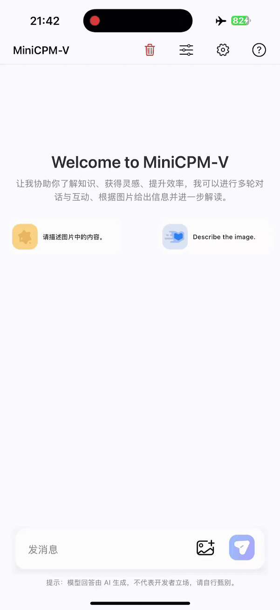

[← 首页](../README_zh.md) · [English](./minicpm_v4dot7_en.md)

# MiniCPM-V 4.7

[端侧结果](#端侧能力与效率) · [性能评估](#性能评估) · [典型示例](#典型示例) · [使用说明](#使用说明) · [模型权重](#模型权重)

**MiniCPM-V 4.7** 是 MiniCPM-V 系列的最新模型，提供 **35BA3B 和 1B** 两种规格，其中 **35BA3B 是 MiniCPM-V 系列首个 MoE 模型**。它延续了系列模型的单图、多图和视频理解能力，在提升基础能力的同时，保持高效的视觉编码与端侧推理，其主要特点包括：

- 📱 **首个端侧无损流畅运行的开源 MoE 模型。**
  基于随 MiniCPM-V 4.7 同步提出的自研 **[LES（前瞻专家调度）](https://github.com/OpenBMB/llama.cpp-omni/blob/main/docs/les/lookahead-expert-scheduling.zh.md)** 技术，配合精细的层级量化与 DSpark 投机采样适配，MiniCPM-V 4.7 35BA3B 成为**首个支持端侧无损流畅运行的开源 MoE 模型**，在 iPhone 17 Pro Max 上以仅 3GB 内存达到 13+ token/s 的解码速度。我们也提供 [1B](https://huggingface.co/openbmb/MiniCPM-V-4.7-1B-DSpark) 和 [35BA3B](https://huggingface.co/openbmb/MiniCPM-V-4.7-35B-A3B-DSpark) 的 **DSpark 投机采样**头。
- 🔥 **性能与效率的新帕累托前沿。**
  随着模型能力不断发展，推理效率也成为衡量模型价值的重要维度；而在资源受限的端侧，更需要在有限的开销内提供尽可能强的能力，追求更高的能力密度。MiniCPM-V 4.7 以 **35BA3B 和 1B** 分别同时刷新了多模态大模型的性能—效率的帕累托前沿。在 Instruct 模式下，35BA3B **以更短的推理时间取得比 Qwen3.6 35BA3B 更高的综合得分**；1B 版本相比 MiniCPM-V 4.6 持续提升基础能力，并在**综合得分和推理效率上均显著领先 Qwen3.5 0.8B**。
- 🚀 **高效架构。**
  MiniCPM-V 4.7 基于 [LLaVA-UHD v4](https://github.com/THUMAI-Lab/LLaVA-UHD-v4) 的 ViT 内提前压缩技术，在视觉编码器内部提前压缩视觉 token，减少后续编码层的计算开销；同时支持 **4 倍/16 倍混合视觉 token 压缩率**，可根据任务需求在视觉细节与推理开销之间灵活取舍。
- 💻 **多平台与芯片支持。**
  MiniCPM-V 4.7 同时支持 **iOS、安卓和鸿蒙**，并提供开源端侧适配代码。同时，**首日支持瑞芯微、后摩、Intel、AMD 和 Arm 等芯片平台**，覆盖更多移动设备与本地计算场景。
- 🛠️ **开发者友好。**
  MiniCPM-V 4.7 适配 SGLang、vLLM、llama.cpp、Ollama 等[推理框架](./deployment_zh.md#训练和推理框架与-api-支持)，支持 SWIFT、LLaMA-Factory 等[微调框架](./deployment_zh.md#训练和推理框架与-api-支持)，提供 GGUF、BNB、AWQ、GPTQ 等量化版本，并新增 **FP8 量化支持**。同步公开 **[Self-Replay Fine-Tuning (SRFT)](https://openbmb.cn/blog/self-replay-fine-tuning)** 微调方案，帮助开发者低成本扩展模型能力、减少原有能力遗忘，方便二次开发。

### 端侧能力与效率

#### 无损且流畅的 MoE 端侧推理

MoE 的总参数量可以远大于单个 token 激活的参数量，但这并不意味着端侧推理只需承担激活参数的存储成本。不同 token 在不同层可能选择不同的专家，而设备内存通常无法容纳全部专家权重。如果不约束时延，可以把权重保存在 SSD 等存储中，计算时按需载入、用后释放，完成大模型推理；频繁加载权重带来的等待，却会使解码速度难以满足实时交互的需求。

另一种办法是缩小可供选择的专家集合。例如，按整段 prompt 固定专家子集，可以降低加载频率，但会将后续 token 的动态路由限制在该子集内，可能排除模型原本会选择的专家，带来能力损失。因此，端侧 MoE 的核心目标是**同时做到无损和流畅**：在保留模型能力的前提下，解决有限内存与带宽下的推理吞吐问题。

MiniCPM-V 4.7 35BA3B 通过三项技术协同实现这一目标：

- **[LES（前瞻专家调度）](https://github.com/OpenBMB/llama.cpp-omni/blob/main/docs/les/lookahead-expert-scheduling.zh.md)**：通过跨层路由预测提前加载下一层可能用到的专家，优先计算实际路由选中且预加载命中的专家，并利用这段计算时间并行加载其余所需专家，减少加载等待。预测仅用于预取与调度，实际计算仍遵循模型原有的 token 级路由；预测未命中的所需专家也会正常加载并参与计算。
- **精细的层级量化**：降低专家权重的存储占用与访存开销，在保持模型能力的前提下，使专家加载更适合端侧的内存与带宽条件。
- **DSpark 投机采样适配**：将投机采样与端侧推理流程结合，与专家调度和量化协同提高解码效率。

这套完整方案使 MiniCPM-V 4.7 35BA3B 成为首个端侧无损流畅运行的开源 MoE 模型，在 iPhone 17 Pro Max 上以仅 3GB 内存达到 13+ token/s 的解码速度。

**MoE 端侧推理优化前后对比**

<p align="center">
  <a href="../assets/minicpmv4.7/moe_speed_comparison_zh.gif"></a>
</p>

### 性能评估

**显著推进性能与推理效率的帕累托前沿**

MiniCPM-V 4.7 的 35BA3B 与 1B 同时刷新了性能—效率帕累托前沿。Instruct 模式下，35BA3B 以更短的推理时间超过 Qwen3.6 35BA3B，1B 在综合得分和推理效率上均显著领先 Qwen3.5 0.8B。

<p align="center">
  <a href="../assets/minicpmv4.7/performance_efficiency_frontier_zh.png"></a>
</p>

**完整性能对比（35BA3B，Instruct）**

**Vision-Language**

<p align="center">
  <a href="../assets/minicpmv4.7/overall_performance_35ba3b_instruct_zh.png"></a>
</p>

**Language**

<p align="center">
  <a href="../assets/minicpmv4.7/overall_performance_35ba3b_language_zh.png"></a>
</p>

**完整性能对比（1B，Instruct）**

<p align="center">
  <a href="../assets/minicpmv4.7/overall_performance_1b_instruct_zh.png"></a>
</p>

### 典型示例

MiniCPM-V 4.7 可以部署在不同的端侧设备上——手机和平板。以下片段为设备上未经剪辑的原始屏幕录制。

<table align="center">
  <tr>
    <td align="center"><b>35BA3B</b><br><sub>iPhone 17 Pro Max</sub></td>
    <td align="center"><b>35BA3B</b><br><sub>iPad M4</sub></td>
    <td align="center"><b>1B</b><br><sub>iPhone 17 Pro Max</sub></td>
  </tr>
  <tr>
    <td align="center"></td>
    <td align="center"></td>
    <td align="center"></td>
  </tr>
</table>

### 使用说明

#### 基于 Transformers 推理 <!-- omit in toc -->
<details>
<summary>点击展开基于 Transformers 的推理示例。</summary>

##### 安装 <!-- omit in toc -->

```bash
pip install "transformers[torch]>=5.18.0" torchvision torchcodec
```

> **CUDA 兼容性提示：** `torchcodec`（用于视频解码）可能与部分 CUDA 版本存在兼容性问题。例如 `torch>=2.11` 默认使用 CUDA 13.1，在 CUDA 12.x 环境下可能出现 `RuntimeError: Could not load libtorchcodec` 等错误。两种解决方案：
>
> 1. **用 `PyAV` 替代 `torchcodec`** —— 图像和视频推理均可正常使用，无 CUDA 版本限制：
>    ```bash
>    pip install "transformers[torch]>=5.18.0" torchvision av
>    ```
> 2. **安装 torch 时指定 CUDA 版本**以匹配当前环境（如 CUDA 12.8）：
>    ```bash
>    pip install "transformers>=5.18.0" torchvision torchcodec --index-url https://download.pytorch.org/whl/cu128
>    ```


##### 加载模型 <!-- omit in toc -->

```python
import torch
from transformers import AutoModelForImageTextToText, AutoProcessor

model_id = "openbmb/MiniCPM-V-4.7-35B-A3B"

processor = AutoProcessor.from_pretrained(model_id)
model = AutoModelForImageTextToText.from_pretrained(
    model_id, torch_dtype="auto", device_map="auto"
)

# 推荐使用 Flash Attention 2 以获得更好的加速与显存节省，
# 尤其在多图和视频场景下效果显著。
# model = AutoModelForImageTextToText.from_pretrained(
#     model_id,
#     torch_dtype=torch.bfloat16,
#     attn_implementation="flash_attention_2",
#     device_map="auto",
# )
```

##### 图片推理 <!-- omit in toc -->

```python
messages = [
    {
        "role": "user",
        "content": [
            {"type": "image", "url": "https://huggingface.co/datasets/openbmb/DemoCase/resolve/main/refract.png"},
            {"type": "text", "text": "What causes this phenomenon?"},
        ],
    }
]

downsample_mode = "16x"  # Using `downsample_mode="4x"` for Finer Detail

inputs = processor.apply_chat_template(
    messages, tokenize=True, add_generation_prompt=True,
    return_dict=True, return_tensors="pt",
    downsample_mode=downsample_mode,
    max_slice_nums=36,
    enable_thinking=False,
).to(model.device)

generated_ids = model.generate(**inputs, downsample_mode=downsample_mode, max_new_tokens=512)
generated_ids_trimmed = [
    out_ids[len(in_ids):] for in_ids, out_ids in zip(inputs.input_ids, generated_ids)
]
output_text = processor.batch_decode(
    generated_ids_trimmed, skip_special_tokens=True, clean_up_tokenization_spaces=False
)
print(output_text[0])
```

##### 视频推理 <!-- omit in toc -->

```python
messages = [
    {
        "role": "user",
        "content": [
            {"type": "video", "url": "https://huggingface.co/datasets/openbmb/DemoCase/resolve/main/football.mp4"},
            {"type": "text", "text": "Describe this video in detail. Follow the timeline and focus on on-screen text, interface changes, main actions, and scene changes."},
        ],
    }
]

downsample_mode = "16x"  # Using `downsample_mode="4x"` for Finer Detail

inputs = processor.apply_chat_template(
    messages, tokenize=True, add_generation_prompt=True,
    return_dict=True, return_tensors="pt",
    downsample_mode=downsample_mode,
    max_num_frames=128,
    stack_frames=1,
    max_slice_nums=1,
    use_image_id=False,
    enable_thinking=False,
).to(model.device)

generated_ids = model.generate(**inputs, downsample_mode=downsample_mode, max_new_tokens=2048)
generated_ids_trimmed = [
    out_ids[len(in_ids):] for in_ids, out_ids in zip(inputs.input_ids, generated_ids)
]
output_text = processor.batch_decode(
    generated_ids_trimmed, skip_special_tokens=True, clean_up_tokenization_spaces=False
)
print(output_text[0])
```

##### 高级参数 <!-- omit in toc -->

可以通过向 `apply_chat_template` 传递额外参数来自定义图片/视频处理行为：

| 参数 | 默认值 | 适用 | 说明 |
|------|--------|------|------|
| `downsample_mode` | `"16x"` | 图片 & 视频 | 视觉 token 下采样模式。`"16x"` 合并 token 以提高效率；`"4x"` 保留 4 倍 token 以获取更精细细节。**必须同时传给 `generate()`**。 |
| `max_slice_nums` | `9` | 图片 & 视频 | 高分辨率图片分片的最大数量。值越大可保留更多大图细节。推荐：图片 `36`，视频 `1`。 |
| `max_num_frames` | `128` | 仅视频 | 从视频中采样的最大主帧数。 |
| `stack_frames` | `1` | 仅视频 | 每秒的总采样点数。`1` = 仅主帧（不堆叠）。`N`（N>1）= 每秒 1 个主帧 + N−1 个子帧；子帧会被拼接为网格图并与主帧交替排列。推荐：`3` 或 `5`。 |
| `use_image_id` | `True` | 图片 & 视频 | 是否在每个图片/帧占位符前添加 `<image_id>N</image_id>` 标签。推荐：图片 `True`，视频 `False`。 |

> **注意：** `downsample_mode` 需要**同时**传给 `apply_chat_template`（确保占位符数量正确）和 `generate`（控制视觉编码器行为）。其他参数只需传给 `apply_chat_template`。

##### 使用 `transformers serve` 部署服务 <!-- omit in toc -->

Hugging Face Transformers 内置了一个轻量级 OpenAI 兼容服务器，适合快速测试和中等负载部署。

```bash
pip install "transformers[serving]>=5.18.0"
```

启动服务：

```bash
transformers serve openbmb/MiniCPM-V-4.7-35B-A3B --port 8000 --host 0.0.0.0
```

发送请求：

```bash
curl -s http://localhost:8000/v1/chat/completions \
  -H 'Content-Type: application/json' \
  -d '{
    "model": "openbmb/MiniCPM-V-4.7-35B-A3B",
    "messages": [{
      "role": "user",
      "content": [
        {"type": "image_url", "image_url": {"url": "https://huggingface.co/datasets/openbmb/DemoCase/resolve/main/refract.png"}},
        {"type": "text", "text": "What causes this phenomenon?"}
      ]
    }]
  }'
```


工具调用示例:

```bash
curl -s http://localhost:8000/v1/chat/completions -H 'Content-Type: application/json' -d '{
  "model": "openbmb/MiniCPM-V-4.7-35B-A3B",
  "messages": [{"role": "user", "content": [
    {"type": "text", "text": "the weather of Beijing"}
  ]}],
  "tools": [{
    "type": "function",
    "function": {
      "name": "get_weather",
      "description": "Get the current weather for a given location",
      "parameters": {
        "type": "object",
        "properties": {
          "location": {"type": "string", "description": "City name"}
        },
        "required": ["location"]
      }
    }
  }]
}'
```

##### 推荐采样参数 <!-- omit in toc -->

我们推荐在 instruct mode 下使用以下采样参数进行生成：`temperature=0.7`、`top_p=0.95`、`top_k=100`、`min_p=0.0`、`presence_penalty=0`、`repetition_penalty=1.03`。

</details>

#### 投机解码 DSpark <!-- omit in toc -->
<details>
<summary>点击展开投机解码。</summary>

投机解码（DSpark）:我们还发布了 [MiniCPM-V-4.7-35B-A3B-DSpark](https://huggingface.co/openbmb/MiniCPM-V-4.7-35B-A3B-DSpark) 和 [MiniCPM-V-4.7-1B-DSpark](https://huggingface.co/openbmb/MiniCPM-V-4.7-1B-DSpark)，它们是分别针对 [MiniCPM-V-4.7-35B-A3B](https://huggingface.co/openbmb/MiniCPM-V-4.7-35B-A3B) 和 [MiniCPM-V-4.7-1B](https://huggingface.co/openbmb/MiniCPM-V-4.7-1B) 训练的 DSpark 草稿模型，用于加速推理。

</details>

#### 基于 OpenVINO™ 推理

[OpenVINO™](https://docs.openvino.ai) 是一个用于在 Intel CPU/GPU/NPU 平台上优化和部署 AI 推理的开源工具包。OpenVINO 首日支持 MiniCPM-V-4.7 在 Intel 平台上的高性能推理。可参考 [OpenVINO™ Toolkit](https://github.com/openvinotoolkit) 快速入门，并通过 [该 notebook](https://github.com/openvinotoolkit/openvino_notebooks/tree/latest/notebooks/minicpm-v-4.7) 安装和运行示例。

#### 端侧部署

MiniCPM-V 4.7 支持 iOS、安卓、鸿蒙部署，并首日支持瑞芯微、后摩、Intel、AMD 和 Arm 等芯片平台。应用与源码可参考[端侧部署仓库](https://github.com/OpenBMB/MiniCPM-V-Apps)。

#### 推理与微调

支持的推理和训练框架见[训练和推理框架与 API 支持](./deployment_zh.md#训练和推理框架与-api-支持)。[MiniCPM-V 4.7 使用手册](https://github.com/OpenSQZ/MiniCPM-V-CookBook/blob/main/docs/pages/v4.7/overview_zh.md)提供部署、微调与量化等使用指南。

**场景教程**

- [单图问答](https://github.com/OpenSQZ/MiniCPM-V-CookBook/blob/main/inference/minicpm-v4_7_single_image_zh.md)
- [多图问答](https://github.com/OpenSQZ/MiniCPM-V-CookBook/blob/main/inference/minicpm-v4_7_multi_images_zh.md)
- [视频理解](https://github.com/OpenSQZ/MiniCPM-V-CookBook/blob/main/inference/minicpm-v4_7_video_understanding_zh.md)
- [OCR](https://github.com/OpenSQZ/MiniCPM-V-CookBook/blob/main/inference/minicpm-v4_7_ocr_zh.md)
- [PDF 解析](https://github.com/OpenSQZ/MiniCPM-V-CookBook/blob/main/inference/minicpm-v4_7_pdf_parse_zh.md)
- [视觉定位](https://github.com/OpenSQZ/MiniCPM-V-CookBook/blob/main/inference/minicpm-v4_7_grounding_zh.md)

**量化**

| 方法 | 指南 |
|:---|:---|
| GGUF | [量化指南](https://github.com/OpenSQZ/MiniCPM-V-CookBook/blob/main/quantization/gguf/minicpm-v4_7_gguf_quantize_zh.md) |
| BNB | [量化指南](https://github.com/OpenSQZ/MiniCPM-V-CookBook/blob/main/quantization/bnb/minicpm-v4_7_bnb_quantize_zh.md) |
| AWQ | [量化指南](https://github.com/OpenSQZ/MiniCPM-V-CookBook/blob/main/quantization/awq/minicpm-v4_7_awq_quantize_zh.md) |
| GPTQ | [量化指南](https://github.com/OpenSQZ/MiniCPM-V-CookBook/blob/main/quantization/gptq/minicpm-v4_7_gptq_quantize_zh.md) |
| FP8 / INT4 | [量化指南](https://github.com/OpenSQZ/MiniCPM-V-CookBook/blob/main/quantization/llmcompressor/minicpm-v4_7_llmcompressor_quantize_zh.md) |

### 致谢

<details>
<summary>点击查看致谢。</summary>

我们对下列项目表示衷心感谢：

* [Qwen3.5](https://huggingface.co/collections/Qwen/qwen35) 和 [Qwen3.6](https://huggingface.co/collections/Qwen/qwen36) 提供了语言基座
* [SigLIP2](https://github.com/google-research/big_vision/blob/main/big_vision/configs/proj/image_text/README_siglip2.md) 提供了视觉理解模块
* [Transformers](https://github.com/huggingface/transformers)

</details>

## 模型权重

MiniCPM-V 4.7 提供以下规格：

| 模型 | 简介 | 下载链接 |
|:---|:---|:---:|
| MiniCPM-V 4.7 35BA3B | 首个可在端侧无损流畅运行的开源 MoE 模型，突破端侧性能上限。 | [🤗](https://huggingface.co/openbmb/MiniCPM-V-4.7-35B-A3B) &nbsp;&nbsp; [</img>](https://modelscope.cn/models/OpenBMB/MiniCPM-V-4.7-35B-A3B) |
| MiniCPM-V 4.7 35BA3B FP8 | FP8 量化版，更低显存占用。 | [🤗](https://huggingface.co/openbmb/MiniCPM-V-4.7-35B-A3B-FP8) &nbsp;&nbsp; [</img>](https://modelscope.cn/models/OpenBMB/MiniCPM-V-4.7-35B-A3B-FP8) |
| MiniCPM-V 4.7 35BA3B int4 | int4 量化版，更低显存占用。 | [🤗](https://huggingface.co/openbmb/MiniCPM-V-4.7-35B-A3B-int4) &nbsp;&nbsp; [</img>](https://modelscope.cn/models/OpenBMB/MiniCPM-V-4.7-35B-A3B-int4) |
| MiniCPM-V 4.7 35BA3B AWQ | AWQ（W4A16）量化版，更低显存占用。 | [🤗](https://huggingface.co/openbmb/MiniCPM-V-4.7-35B-A3B-AWQ) &nbsp;&nbsp; [</img>](https://modelscope.cn/models/OpenBMB/MiniCPM-V-4.7-35B-A3B-AWQ) |
| MiniCPM-V 4.7 35BA3B GPTQ | GPTQ（W4A16）量化版，更低显存占用。 | [🤗](https://huggingface.co/openbmb/MiniCPM-V-4.7-35B-A3B-GPTQ) &nbsp;&nbsp; [</img>](https://modelscope.cn/models/OpenBMB/MiniCPM-V-4.7-35B-A3B-GPTQ) |
| MiniCPM-V 4.7 35BA3B GGUF | GGUF 版本，更低的内存占用，适合 CPU 推理。 | [🤗](https://huggingface.co/openbmb/MiniCPM-V-4.7-35B-A3B-gguf) &nbsp;&nbsp; [</img>](https://modelscope.cn/models/OpenBMB/MiniCPM-V-4.7-35B-A3B-gguf) |
| MiniCPM-V 4.7 35BA3B DSpark | DSpark 投机解码 draft 模型。 | [🤗](https://huggingface.co/openbmb/MiniCPM-V-4.7-35B-A3B-DSpark) &nbsp;&nbsp; [</img>](https://modelscope.cn/models/OpenBMB/MiniCPM-V-4.7-35B-A3B-DSpark) |
| MiniCPM-V 4.7 1B | 兼顾能力提升与超高效率，多模态大模型效率-效果帕累托新前沿。 | [🤗](https://huggingface.co/openbmb/MiniCPM-V-4.7-1B) &nbsp;&nbsp; [</img>](https://modelscope.cn/models/OpenBMB/MiniCPM-V-4.7-1B) |
| MiniCPM-V 4.7 1B int4 | bitsandbytes int4 量化版，更低显存占用。 | [🤗](https://huggingface.co/openbmb/MiniCPM-V-4.7-1B-int4) &nbsp;&nbsp; [</img>](https://modelscope.cn/models/OpenBMB/MiniCPM-V-4.7-1B-int4) |
| MiniCPM-V 4.7 1B AWQ | AWQ（W4A16）量化版，更低显存占用。 | [🤗](https://huggingface.co/openbmb/MiniCPM-V-4.7-1B-AWQ) &nbsp;&nbsp; [</img>](https://modelscope.cn/models/OpenBMB/MiniCPM-V-4.7-1B-AWQ) |
| MiniCPM-V 4.7 1B GPTQ | GPTQ（W4A16）量化版，更低显存占用。 | [🤗](https://huggingface.co/openbmb/MiniCPM-V-4.7-1B-GPTQ) &nbsp;&nbsp; [</img>](https://modelscope.cn/models/OpenBMB/MiniCPM-V-4.7-1B-GPTQ) |
| MiniCPM-V 4.7 1B GGUF | GGUF 版本，更低的内存占用，适合 CPU 推理。 | [🤗](https://huggingface.co/openbmb/MiniCPM-V-4.7-1B-gguf) &nbsp;&nbsp; [</img>](https://modelscope.cn/models/OpenBMB/MiniCPM-V-4.7-1B-gguf) |
| MiniCPM-V 4.7 1B DSpark | DSpark 投机解码 draft 模型。 | [🤗](https://huggingface.co/openbmb/MiniCPM-V-4.7-1B-DSpark) &nbsp;&nbsp; [</img>](https://modelscope.cn/models/OpenBMB/MiniCPM-V-4.7-1B-DSpark) |

也可通过 [Ollama](https://ollama.com/openbmb/minicpm-v4.7) 下载。
