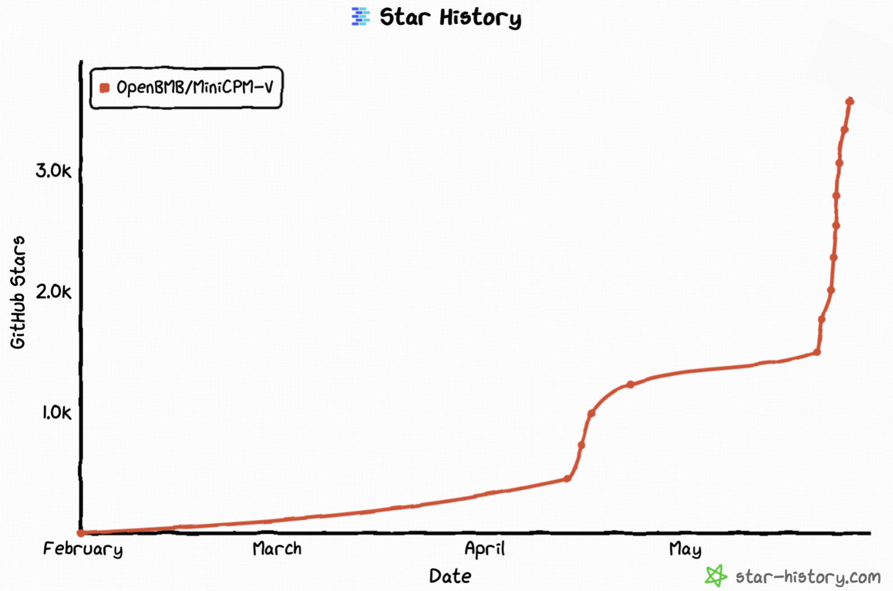

[← Home](../README.md) · [中文](./project_zh.md)

# Project Resources

[Legacy models](#legacy-models) · [Community projects](#awesome-work-using-minicpm-v--o) · [License](#model-license) · [Papers](#technical-reports-and-key-techniques-papers) · [Citation](#citation)

## Legacy Models

| Model                | Introduction and Guidance       |
|:----------------------|:-------------------:|
| MiniCPM-V 4.6 | [Document](./minicpm_v4dot6_en.md) |
| MiniCPM-V 4.0  | [Document](./minicpm_v4_en.md)   |
| MiniCPM-V 4.5  | [Document](./minicpm_v4dot5_en.md)   | 
| MiniCPM-o 2.6  | [Document](./minicpm_o2dot6_en.md)   | 
| MiniCPM-V 2.6  | [Document](./minicpm_v2dot6_en.md)   | 
| MiniCPM-Llama3-V 2.5  | [Document](./minicpm_llama3_v2dot5.md)   | 
| MiniCPM-V 2.0  | [Document](./minicpm_v2.md)   | 
| MiniCPM-V 1.0  | [Document](./minicpm_v1.md)   | 
| OmniLMM-12B  | [Document](./omnilmm_en.md)   |  


## Awesome work using MiniCPM-V & o
- [text-extract-api](https://github.com/CatchTheTornado/text-extract-api): Document extraction API using OCRs and Ollama supported models 
- [comfyui_LLM_party](https://github.com/heshengtao/comfyui_LLM_party): Build LLM workflows and integrate into existing image workflows 
- [Ollama-OCR](https://github.com/imanoop7/Ollama-OCR): OCR package uses vlms through Ollama to extract text from images and PDF 
- [comfyui-mixlab-nodes](https://github.com/MixLabPro/comfyui-mixlab-nodes): ComfyUI node suite supports Workflow-to-APP、GPT&3D and more 
- [OpenAvatarChat](https://github.com/HumanAIGC-Engineering/OpenAvatarChat): Interactive digital human conversation implementation on single PC 
- [pensieve](https://github.com/arkohut/pensieve): A privacy-focused passive recording project by recording screen content 
- [paperless-gpt](https://github.com/icereed/paperless-gpt): Use LLMs to handle paperless-ngx, AI-powered titles, tags and OCR 
- [Neuro](https://github.com/kimjammer/Neuro): A recreation of Neuro-Sama, but running on local models on consumer hardware 

## Model License

* The MiniCPM-o/V model weights and code are open-sourced under the [Apache-2.0](https://github.com/OpenBMB/MiniCPM-V/blob/main/LICENSE) license.

* To help us better understand and support our users, we would deeply appreciate it if you could consider optionally filling out a brief registration ["questionnaire"](https://modelbest.feishu.cn/share/base/form/shrcnpV5ZT9EJ6xYjh3Kx0J6v8g).

## Statement

As MLLMs, MiniCPM-o/V models generate content by learning a large number of multimodal corpora, but they cannot comprehend, express personal opinions, or make value judgements. Anything generated by MiniCPM-o/V models does not represent the views and positions of the model developers

We will not be liable for any problems arising from the use of MiniCPM-o/V models, including but not limited to data security issues, risk of public opinion, or any risks and problems arising from the misdirection, misuse, dissemination, or misuse of the model.

## Institutions

This project is developed by the following institutions:

-  [THUNLP](https://nlp.csai.tsinghua.edu.cn/)
-  [ModelBest](https://modelbest.cn/)

## 🌟 Star History

<p align="center">
  <a href="https://github.com/OpenBMB/MiniCPM-V/stargazers">
    
  </a>
</p>

## Technical Reports and Key Techniques Papers

👏 Welcome to explore key techniques and research of MiniCPM-o/V:

**Technical Reports:** [MiniCPM-o 4.5](https://huggingface.co/papers/2604.27393) | [MiniCPM-V 4.5](https://arxiv.org/abs/2509.18154) | [MiniCPM-o 2.6](https://openbmb.notion.site/MiniCPM-o-2-6-A-GPT-4o-Level-MLLM-for-Vision-Speech-and-Multimodal-Live-Streaming-on-Your-Phone-185ede1b7a558042b5d5e45e6b237da9) | [MiniCPM-Llama3-V 2.5](https://arxiv.org/abs/2408.01800) | [MiniCPM-V 2.0](https://openbmb.vercel.app/minicpm-v-2)

**Research:** [LLaVA-UHD](https://github.com/thunlp/LLaVA-UHD) | [VisCPM](https://github.com/OpenBMB/VisCPM/tree/main) | [RLPR](https://github.com/OpenBMB/RLPR) | [RLHF-V](https://github.com/RLHF-V/RLHF-V)   | [RLAIF-V](https://github.com/RLHF-V/RLAIF-V) | [LLaVA-UHD-v4](https://arxiv.org/abs/2605.08985)


## Citation

If you find our model/code/paper helpful, please consider citing our papers 📝 and staring us ⭐️！

```bib
@misc{cui2026minicpmo45realtimefullduplex,
      title={MiniCPM-o 4.5: Towards Real-Time Full-Duplex Omni-Modal Interaction}, 
      author={Junbo Cui and Bokai Xu and Chongyi Wang and Tianyu Yu and Weiyue Sun and Yingjing Xu and Tianran Wang and Zhihui He and Wenshuo Ma and Tianchi Cai and others},
      year={2026},
      url={https://arxiv.org/abs/2604.27393}, 
}

@proceedings{yu2025minicpmv45cookingefficient,
      title={MiniCPM-V 4.5: Cooking Efficient MLLMs via Architecture, Data, and Training Recipe}, 
      author={Tianyu Yu and Zefan Wang and Chongyi Wang and Fuwei Huang and Wenshuo Ma and Zhihui He and Tianchi Cai and Weize Chen and Yuxiang Huang and Yuanqian Zhao and others},
      year={2025},
      url={https://arxiv.org/abs/2509.18154}, 
}

@article{yao2024minicpm,
  title={MiniCPM-V: A GPT-4V Level MLLM on Your Phone},
  author={Yao, Yuan and Yu, Tianyu and Zhang, Ao and Wang, Chongyi and Cui, Junbo and Zhu, Hongji and Cai, Tianchi and Li, Haoyu and Zhao, Weilin and He, Zhihui and others},
  journal={arXiv preprint arXiv:2408.01800},
  year={2024}
}
```
